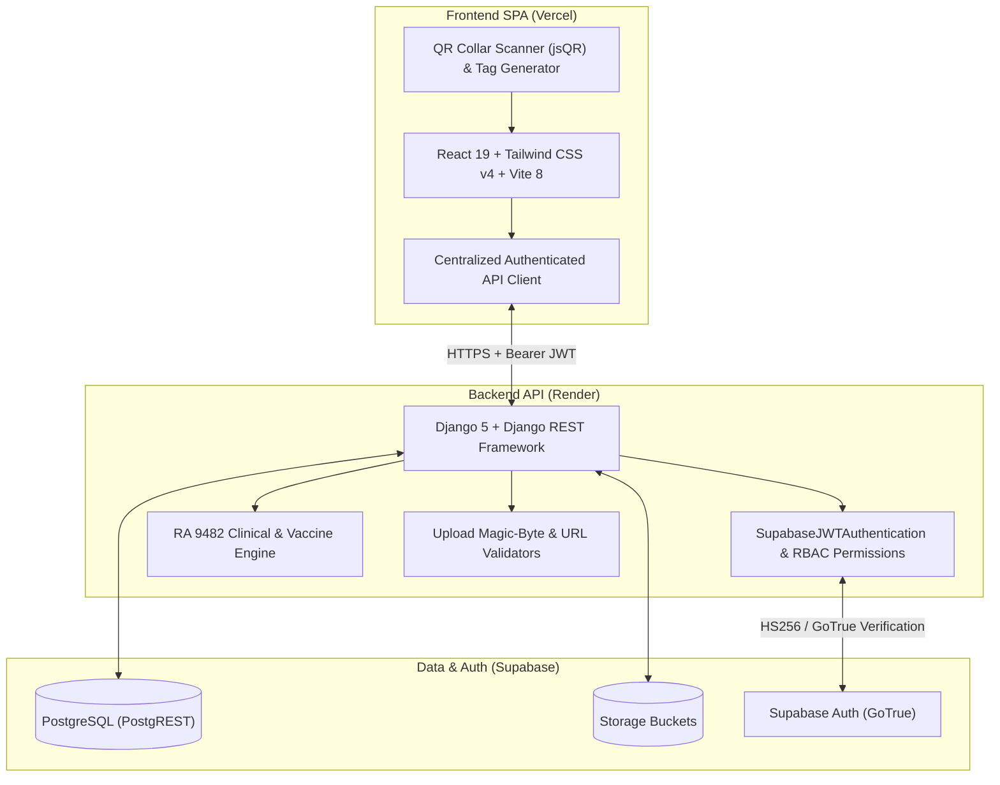

# Task Force Bruno — Wildcat Welfare Portal

Full-stack campus animal registry, veterinary medical tracking, supply inventory, community sighting triage, and adoption platform built for **Cebu Institute of Technology – University (CIT-U)**.

[](https://react.dev/)
[](https://vitejs.dev/)
[](https://tailwindcss.com/)
[](https://www.djangoproject.com/)
[](https://www.django-rest-framework.org/)
[](https://supabase.com/)

---

## Core Capabilities

- **Role-Based Portals (`@cit.edu`)**: Separate Community (students/faculty/staff) and MDC Operations Staff workspaces backed by server-verified Supabase JWT authentication and 15-minute idle session timeout.
- **Campus Pet Registry & QR Collar Passports**: Public scannable pet passports (`/pet/<PET-ID>`), live camera & photo-upload QR scanning (`jsQR`), 300 DPI printable CIT-U collar tags, and natural-language trait search (supporting negation and local terms such as *aspin* / *puspin*).
- **Clinical & Immunization Records (RA 9482)**: Wellness exams, treatment logs, TNR spay/neuter certification, automatic 14-day rabies bite/scratch observation tracking, species-vaccine compatibility checks, and a campus-wide booster alert matrix.
- **Adoption Pipeline**: Adoptable companion gallery, validated multi-field adoption forms, applicant status tracking with self-withdrawal, staff review queue, and automatic closing of competing pending applications upon placement.
- **Community Newsfeed & Sighting Triage**: Official MDC bulletins, urgent rescue alerts, sighting verification & stray intake handoff, likes, and moderated comments.
- **Supply Inventory & Audit Ledger**: Stock catalog for food, medical supplies, and gear; strict unit validation; non-negative stock guards; customizable low-stock thresholds; and full IN/OUT transaction history.
- **Mobile-First Responsive UI**: Dynamic viewport height (`100dvh`), adaptive mobile bottom navigation for both Community and Staff portals, mobile card views replacing wide tables, and keyboard-safe form ergonomics.

---

## System Architecture



---

## Security Controls

- **Cryptographic JWT Authentication**: Every protected endpoint verifies the Bearer JWT via HS256 (`SUPABASE_JWT_SECRET`) or Supabase GoTrue (`auth.get_user`) with a short-lived bounded cache; client-supplied emails and roles are never trusted for identity or authorization.
- **Strict RBAC & Ownership Enforcement**: Staff-only routes enforce `IsMDCStaff` (returning `403` for regular users); non-staff users can only view/withdraw their own adoption applications, view their own sighting submissions, and edit/delete their own comments.
- **Safe File Uploads**: Image uploads enforce a 5 MB limit, extension/MIME allowlists, and binary magic-byte verification (JPEG, PNG, WebP, GIF) to block SVG/HTML polyglots.
- **Production Hardening**: Strict CORS allowlisting, DRF rate limiting, HSTS/SSL/XSS/frame headers (`manage.py check --deploy` passes with zero warnings), Vercel SPA security headers, and non-leaking error responses.

---

## API Endpoint Reference

All API routes are mounted under `/api/`:

| Domain | Endpoints | Access |
| :--- | :--- | :--- |
| **Auth & Health** | `POST /register/`, `POST /login/`, `GET /session/`, `POST /logout/`, `GET /health/` | Public / Authenticated |
| **Pet Registry** | `GET /pets/`, `GET /pets/<pet_id>/` | Public (QR passports) |
| **Pet Admin & Search** | `POST /pets/`, `PUT/DELETE /pets/<pet_id>/` \| `POST /pets/ai-search/` | Staff \| Authenticated |
| **Clinical & Vaccines** | `GET/POST /medical/<pet_id>/`, `GET/POST /vaccinations/<pet_id>/` | Staff (pet vaccine read: Auth) |
| **Adoptions** | `GET/POST /pets/applications/`, `PUT /pets/applications/<id>/` | Authenticated (scoped) / Staff |
| **Inventory** | `GET /inventory/`, `POST/PUT/DELETE /inventory/...`, `GET/POST /inventory/transactions/` | Auth (read) / Staff (write) |
| **Sightings** | `GET/POST /sightings/`, `PUT /sightings/<id>/` | Authenticated (scoped) / Staff |
| **Feed & Bulletins** | `GET /newsfeed/`, `POST /newsfeed/like/`, `POST /newsfeed/comment/`, `PUT/DELETE /newsfeed/comment/action/`, `PUT/DELETE /newsfeed/action/`, `GET/POST /announcements/` | Authenticated / Staff |

---

## Local Development

### Prerequisites
- Python 3.10+
- Node.js 18+
- A configured Supabase project

### Backend (`backend/`)

```bash
cd backend
python -m venv venv
# Windows PowerShell:
.\venv\Scripts\Activate.ps1
# macOS / Linux:
# source venv/bin/activate

pip install -r requirements.txt
cp .env.example .env   # Fill in Supabase credentials and DJANGO_SECRET_KEY
python manage.py runserver
```

Run backend verification checks:

```bash
python manage.py check --deploy
python manage.py test wsapi -v 2
```

### Frontend (`frontend/`)

```bash
cd frontend
npm install
cp .env.example .env.local   # Optional: override VITE_API_BASE_URL for local backend
npm run dev
```

Run frontend checks:

```bash
npm run lint
npm run build
```

---

## Project Documentation

Capstone and validation documentation is maintained in [`docs/`](docs/):
- [MVP Validation Plan](docs/MVP_VALIDATION_PLAN.md)
- [Software Test Document](docs/SOFTWARE_TEST_DOCUMENT.md)
- [MVP Validation Highlights](docs/MVP_VALIDATION_HIGHLIGHTS.md)
