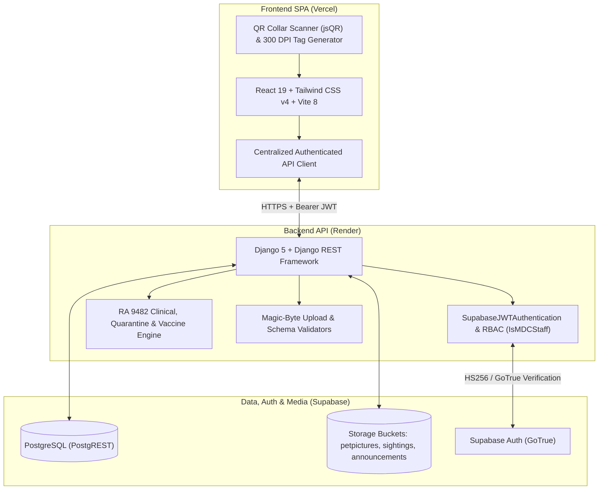

<div align="center">


# Task Force Bruno — Wildcat Welfare Portal

**Full-stack campus animal registry, RA 9482 veterinary clinical tracking, supply inventory, community sighting triage, and adoption platform built for Cebu Institute of Technology – University (CIT-U).**

[](https://react.dev/)
[](https://vitejs.dev/)
[](https://tailwindcss.com/)
[](https://www.djangoproject.com/)
[](https://www.django-rest-framework.org/)
[](https://supabase.com/)
[](https://www.python.org/)

[Live Portal](https://taskforcebruno.vercel.app) • [API Health](https://taskforcebruno.onrender.com/api/health/) • [Capabilities](#core-capabilities) • [Architecture](#system-architecture) • [API Reference](#api-endpoint-reference) • [Local Setup](#local-development) • [Documentation](#project-documentation)

</div>

---

## Overview

**Task Force Bruno (Wildcat Welfare Portal)** digitizes and coordinates campus companion animal stewardship at **Cebu Institute of Technology – University (CIT-U)**. The platform connects the university community (students, faculty, and staff) with Medical & Dental Clinic (MDC) operations staff across five core workflows:

- **Identification & Tracking:** Public scannable QR collar passports, live camera/upload QR decoding, 300 DPI printable CIT-U collar tags, and natural-language trait search.
- **Veterinary & RA 9482 Compliance:** Longitudinal clinical logs, species-specific vaccine validation, Trap-Neuter-Return (TNR) certification, booster alerts, and automated 14-day rabies bite/scratch observation tracking.
- **Adoption & Rehoming:** Verified adoption applications, applicant self-service status tracking and withdrawal, staff review triage, and automatic closure of competing pending requests on placement.
- **Community Safety & Triage:** Unified campus newsfeed with official bulletins, urgent alerts, sighting reports with photo evidence, likes, and moderated comments.
- **Supply Logistics:** Centralized food, medical supply, and gear inventory with customizable low-stock thresholds, non-negative stock guards, and a full IN/OUT audit ledger.

---

## Core Capabilities

### 1. Role-Based Portals & Institutional Auth
- **CIT-U Identity Enforcement:** Account registration requires an institutional `@cit.edu` email address and `XX-XXXX-XXX` ID format.
- **Role-Synchronized Routing:** Automatically routes authenticated sessions to `/student/dashboard` (Community Portal) or `/mdc/dashboard` (MDC Operations Portal), with `/mdc/*` routes guarded against unauthorized access.
- **Session Hardening:** Server-verified JWT session sync (`GET /api/session/`), global `401` expiry handling, and a 15-minute sliding inactivity timeout designed for shared campus devices.

### 2. Community Portal (`/student/dashboard`)
- **Community Newsfeed:** Chronological stream of official MDC bulletins and verified sightings with 1-click category filters, likes, and editable/deletable user comments.
- **Pet Directory:** View-only catalog of registered campus companions and unadopted strays with live health and vaccination indicators.
- **Collar QR Scanner & AI Trait Search:** Live camera viewfinder and photo-upload QR decoding (`jsQR`), manual ID lookup, and natural-language trait search supporting negation and local terms (e.g., *aspin*, *puspin*).
- **Adoption Portal:** Adoptable companion gallery (including all unadopted strays by default), validated multi-field adoption form, and applicant status tracker with self-withdrawal.
- **Report Sighting:** Campus sighting submission with location metadata, urgency flags, and validated image uploads.
- **Support, Supplies & Safety:** Volunteer/support directory, read-only supply logistics visibility, an onboarding User Guide modal, and a quick-access Emergency Protocol modal.

### 3. MDC Operations Staff Portal (`/mdc/dashboard`)
- **Pet Registry & Collar Tags:** Full CRUD management for campus pets and strays, photo uploads, and 300 DPI printable CIT-U QR collar tag generation.
- **Clinical & Immunization Logs (RA 9482):** Wellness exams, treatment notes, TNR spay/neuter synchronization, species-specific vaccine compatibility checks (canine vs. feline), automatic 14-day rabies quarantine tracking with expiry calculation, and a campus-wide booster alert matrix.
- **Adoption Review Queue:** Review applicant household/care details, approve or reject applications, transition pets to *Adopted* status, and automatically close competing pending applications.
- **Sighting Triage & Broadcasts:** Verify or resolve community sighting reports, escalate verified strays into registry intake, moderate feed activity, and publish official campus bulletins.
- **Inventory Control & Audit Ledger:** Add/edit/remove supplies, enforce unit and non-negative quantity rules, configure low-stock alerts, and log IN/OUT transactions with staff attribution.

### 4. Public QR Collar Passports & Mobile-First UI
- **Unauthenticated Passports (`/pet/<PET-ID>` & `/passport/<PET-ID>`):** Scanning any campus collar tag opens a viewport-constrained, mobile-friendly passport modal showing pet identity, vaccination status, quarantine/alert indicators, and campus contact info without requiring login.
- **Responsive Engineering:** Dynamic viewport height (`100dvh`), adaptive mobile bottom navigation for both portals, mobile card views replacing wide data tables, and route/vendor code splitting (`react-vendor`, `qr-tools`, `icons`).

---

## System Architecture



---

## Tech Stack

| Layer | Technology | Details |
| :--- | :--- | :--- |
| **Frontend** | React 19.2, Vite 8.0, Tailwind CSS 4.3 | Code-split SPA with CIT-U Maroon (`#5C0612`) & Gold (`#D4AF37`) theme and `lucide-react` icons |
| **QR & Vision** | `jsqr` 1.4, `qrcode` 1.5 | Client-side live camera/image QR decoding and high-resolution collar tag rendering |
| **Backend** | Django 5.0.4, Django REST Framework 3.15.1 | REST API, scoped throttling, RA 9482 clinical rules, NLP trait scoring, magic-byte validation |
| **Auth** | Supabase Auth (GoTrue), PyJWT 2.13 | Server-verified Bearer JWTs (HS256 or GoTrue fallback) with role-based permissions |
| **Data & Media** | Supabase PostgreSQL (PostgREST), Supabase Storage | Relational tables plus dedicated media buckets (`petpictures`, `sightings`, `announcements`) |
| **Hosting** | Vercel (Frontend), Render (Backend via Gunicorn) | SPA security headers, strict CORS allowlisting, HTTPS/HSTS enforcement |

---

## Project Structure

```text
taskforcebruno/
├── backend/
│   ├── manage.py
│   ├── requirements.txt
│   ├── .env.example
│   ├── task_force_bruno/        # Django project settings, URLs, WSGI/ASGI
│   └── wsapi/
│       ├── authentication.py    # SupabaseJWTAuthentication & AuthenticatedUser
│       ├── clinical.py          # RA 9482 quarantine, TNR, & vaccine compatibility logic
│       ├── models.py            # Unmanaged Django models (Pet, AdoptionApplication)
│       ├── permissions.py       # IsMDCStaff & role-based access controls
│       ├── supabase_client.py   # Supabase PostgREST / Auth / Storage client factory
│       ├── urls.py              # /api/ route definitions
│       ├── validators.py        # @cit.edu, ID/phone, date, & image magic-byte validators
│       ├── views.py             # DRF API views across all domains
│       └── tests.py             # Backend test suite (26 tests)
├── frontend/
│   ├── index.html
│   ├── package.json
│   ├── vercel.json              # SPA rewrites & security headers
│   ├── vite.config.js           # Vendor & QR chunk splitting
│   ├── .env.example
│   ├── public/
│   │   └── logo.png             # Wildcat Welfare Portal emblem & favicon
│   └── src/
│       ├── App.jsx              # Role-synced routing, session sync, idle timeout, public passport
│       ├── components/          # Community portal, Staff portal, Clinical, Inventory, QR & Feed views
│       └── lib/                 # api.js, auth.js, dates.js, pets.js, qr.js
└── docs/                        # SRS, SDD, STD, RTM, Validation Plan, and PDF/DOCX deliverables
```

---

## Database & Storage Schema

The backend integrates with Supabase PostgreSQL tables via PostgREST and three Supabase Storage buckets:

| Table | Purpose |
| :--- | :--- |
| `profiles` | Institutional `@cit.edu` user accounts, custom IDs (`XX-XXXX-XXX`), and roles (`user` / `staff`) |
| `pets` | Master registry of campus companions, strays, adoption/vaccination/TNR status, and traits |
| `pet_images` | Primary and supplemental pet photos linked to `pets` |
| `medical_records` | Clinical logs, diagnoses, treatments, TNR entries, and RA 9482 bite/scratch quarantine logs |
| `vaccination_logs` | Immunization records with vaccine type, administered dates, and next due dates |
| `adoption_applications` | Multi-field adoption submissions linked to `pets` and applicant accounts |
| `animal_sightings` | Community sighting reports with location, urgency, photo URL, and triage status |
| `campus_announcements` | Official MDC bulletins and broadcasts displayed on the newsfeed |
| `feed_likes` & `feed_comments` | Social engagement records scoped to newsfeed items |
| `inventory` | Campus food, medical supplies, and equipment stock levels and low-stock thresholds |
| `inventory_transactions` | Immutable IN/OUT stock movement audit ledger |

**Storage Buckets:** `petpictures` (registry photos), `sightings` (sighting evidence), and `announcements` (bulletin attachments).

---

## Security Controls

- **Cryptographic JWT Authentication:** Protected routes verify Bearer JWTs via local HS256 (`SUPABASE_JWT_SECRET`) or Supabase GoTrue (`auth.get_user`) with a bounded short-lived cache; client-supplied roles or emails are never trusted.
- **Strict RBAC & Ownership Scoping:** Administrative endpoints enforce `IsMDCStaff` (`403` for non-staff). Community users can only view/withdraw their own adoption applications, view their own sighting submissions, and edit/delete their own comments.
- **Validated File Uploads:** Image uploads enforce a 5 MB size cap (6 MB request cap), extension/MIME allowlists, and binary magic-byte inspection (`JPEG`, `PNG`, `WebP`, `GIF`) to reject spoofed files and SVG/HTML polyglots.
- **Rate Limiting & Hardening:** DRF rate limits (`anon: 120/min`, `user: 300/min`, `auth: 15/min`, `search: 60/min`), explicit CORS origin allowlisting with scoped Vercel preview matching, production HSTS/SSL/cookie/frame headers (`manage.py check --deploy` passes with zero warnings), and Vercel `Permissions-Policy` / `X-Frame-Options` headers.

---

## API Endpoint Reference

All backend routes are mounted under `/api/`:

| Domain | Endpoints | Access |
| :--- | :--- | :--- |
| **Auth & Health** | `POST /register/`, `POST /login/`, `GET /session/`, `POST /logout/`, `GET /health/` | Public / Authenticated |
| **Pet Registry** | `GET /pets/`, `GET /pets/<pet_id>/` | Public (QR passports) |
| **Pet Admin & Search** | `POST /pets/`, `PUT/DELETE /pets/<pet_id>/` \| `POST /pets/ai-search/` | Staff \| Authenticated |
| **Clinical & Vaccines** | `GET/POST /medical/log/`, `GET/POST /medical/<pet_id>/`, `GET/POST /vaccinations/<pet_id>/` | Staff (pet vaccine read: Auth) |
| **Adoptions** | `GET/POST /pets/applications/`, `PUT /pets/applications/<application_id>/` | Authenticated (scoped) / Staff |
| **Inventory** | `GET /inventory/`, `POST /inventory/`, `PUT/DELETE /inventory/<item_id>/`, `GET/POST /inventory/transactions/` | Auth (read) / Staff (write) |
| **Sightings** | `GET/POST /sightings/`, `PUT /sightings/<sighting_id>/` | Authenticated (scoped) / Staff |
| **Feed & Bulletins** | `GET /newsfeed/`, `POST /newsfeed/like/`, `POST /newsfeed/comment/`, `PUT/DELETE /newsfeed/comment/action/`, `PUT/DELETE /newsfeed/action/`, `GET/POST /announcements/` | Authenticated / Staff |

---

## Local Development

### Prerequisites
- **Python 3.10+** (with `pip` and `venv`)
- **Node.js 18+** / **npm 9+**
- A configured **Supabase** project

### Backend (`backend/`)

```bash
git clone https://github.com/yuclark/taskforcebruno.git
cd taskforcebruno/backend

python -m venv venv
# Windows (PowerShell):
.\venv\Scripts\Activate.ps1
# macOS / Linux:
# source venv/bin/activate

pip install -r requirements.txt
cp .env.example .env   # Fill in Supabase credentials and DJANGO_SECRET_KEY
python manage.py runserver
```

Run backend verification and unit tests (26 tests):

```bash
python manage.py check --deploy
python manage.py test wsapi -v 2
```

### Frontend (`frontend/`)

```bash
cd taskforcebruno/frontend
npm install
cp .env.example .env.local   # Set VITE_API_BASE_URL=http://127.0.0.1:8000/api for local backend
npm run dev
```

Run frontend linting and production build:

```bash
npm run lint
npm run build
```

### Environment Variables Reference

| Variable | Scope | Required | Description |
| :--- | :--- | :---: | :--- |
| `DJANGO_SECRET_KEY` | Backend | Yes | Cryptographic signing key (50+ random chars in production) |
| `DEBUG` | Backend | No | Set `True` for local development (defaults to `False`) |
| `SUPABASE_URL` | Backend | Yes | Supabase project URL (`https://<ref>.supabase.co`) |
| `SUPABASE_SERVICE_ROLE_KEY` | Backend | Yes | Service role key used by backend PostgREST/Storage operations |
| `SUPABASE_ANON_KEY` | Backend | Recommended | Supabase anon key for auth flows |
| `SUPABASE_JWT_SECRET` | Backend | Optional | Enables local HS256 JWT verification without extra GoTrue roundtrips |
| `DATABASE_URL` | Backend | Optional | Direct PostgreSQL connection string (defaults to local SQLite) |
| `FRONTEND_VERCEL_URL` | Backend | Optional | Additional allowed CORS frontend origin (e.g., `http://localhost:5173`) |
| `EXTRA_CORS_ORIGINS` | Backend | Optional | Comma-separated extra CORS origins |
| `MDC_STAFF_EMAILS` | Backend | Optional | Comma-separated fallback allowlist of institutional staff emails |
| `VITE_API_BASE_URL` | Frontend | Optional | Backend API URL (defaults to Render production URL; automatically normalizes the `/api` suffix) |
| `VITE_PUBLIC_APP_URL` | Frontend | Optional | Public origin embedded in generated 300 DPI collar QR tags (defaults to `window.location.origin`) |

---

## Project Documentation

Capstone, requirements, design, testing, and validation documentation is maintained in [`docs/`](docs/):

- **Validation Plan:** [MVP_VALIDATION_PLAN.md](docs/MVP_VALIDATION_PLAN.md) ([Word](docs/Task_Force_Bruno_MVP_Validation_Plan.docx) | [PDF](docs/Task_Force_Bruno_MVP_Validation_Plan.pdf))
- **Validation Highlights:** [MVP_VALIDATION_HIGHLIGHTS.md](docs/MVP_VALIDATION_HIGHLIGHTS.md) ([PDF](docs/Task_Force_Bruno_MVP_Validation_Highlights.pdf))
- **Refactoring Report:** [MVP Validation Refactoring Report (PDF)](docs/Task_Force_Bruno_MVP_Validation_Refactoring_Report.pdf)
- **Software Test Document (STD):** [SOFTWARE_TEST_DOCUMENT.md](docs/SOFTWARE_TEST_DOCUMENT.md) ([PDF](docs/Task_Force_Bruno_Software_Test_Document_STD.pdf))
- **Requirements & Traceability:** [REQUIREMENTS_INVENTORY_AND_TRACEABILITY_MATRIX.md](docs/REQUIREMENTS_INVENTORY_AND_TRACEABILITY_MATRIX.md) ([PDF](docs/Task_Force_Bruno_Requirements_Inventory_and_Traceability_Matrix.pdf))
- **SRS & SDD:** [srsupdated.pdf](docs/srsupdated.pdf) | [sddupdated.docx](docs/sddupdated.docx)

---

## Institutional Context

| Attribute | Details |
| :--- | :--- |
| **Institution** | [Cebu Institute of Technology – University (CIT-U)](https://cit.edu/) |
| **Project** | Task Force Bruno — Wildcat Welfare Portal |
| **Track** | Capstone / Information Technology |

<div align="center">

*Built for compassionate campus companion stewardship and community safety at CIT-U.*

</div>
